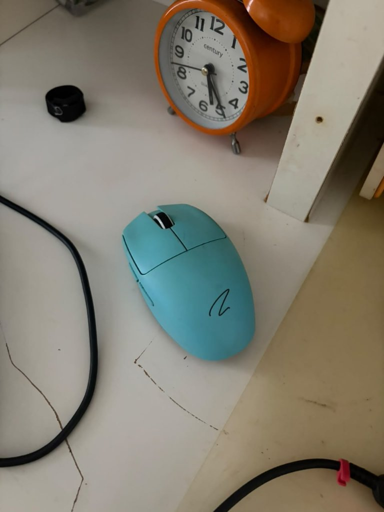
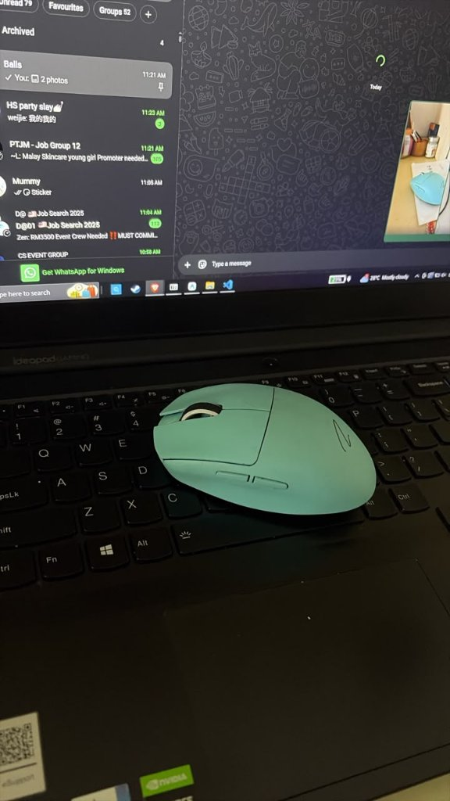
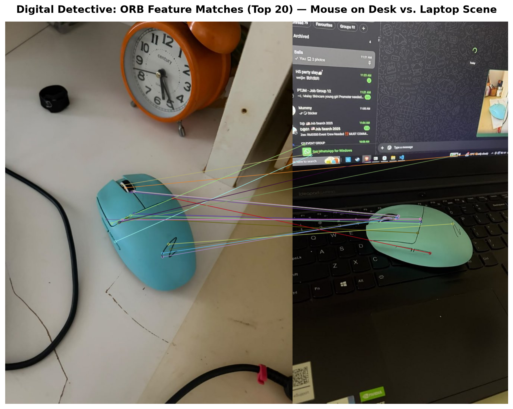
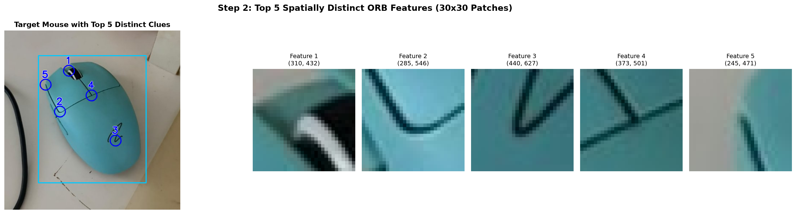
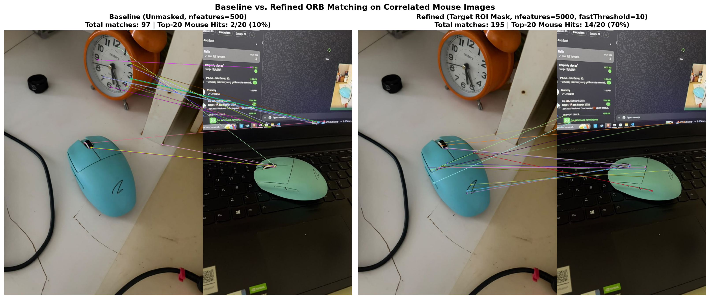

# Digital Detective: ORB Feature Extraction Challenge

Computer vision lab implementing **ORB (Oriented FAST and Rotated BRIEF)** feature extraction, description, and Hamming-distance matching on two correlated custom photographs of a teal wireless gaming mouse.

---

## Correlated Input Images

Both images feature the **exact same teal wireless gaming mouse** captured in two distinct environments to test object localization under real-world viewpoint, lighting, and background changes:

| Target Image | Cluttered Scene |
| :---: | :---: |
|  |  |
| `images/mouse_target.jpg` (`768×1024`) | `images/mouse_scene.jpg` (`576×1024`) |

**Image Correlation & Challenge Factors:**
- **Shared Target Object:** Same matte teal wireless mouse with a black-and-white recessed scroll wheel, two-piece click button seam, side thumb buttons, and dark stylized palm logo.
- **Transformations Between Images:**
  1. **~65°–70° in-plane rotation** and **oblique 3D perspective tilt** (top-down vertical orientation on the desk vs. rotated horizontal side-angle on the laptop keyboard).
  2. **Background contrast inversion:** Light white/beige desk (`mouse < background`) vs. black Lenovo IdeaPad Gaming keyboard (`mouse > background`).
  3. **Illumination shift:** Warm ambient desk lighting vs. dimmer, cooler lighting next to a bright laptop screen.
  4. **Heavy visual clutter:** Orange analog alarm clock & desk cables in the target photo; WhatsApp Web chat list & Windows taskbar in the scene photo.

---

## Final Result Image



### Top 5 Spatially Distinct Clues on Target Mouse (`30×30` Patches)



### Baseline vs. Refined Comparison



| Pipeline Configuration | Target Keypoints | Scene Keypoints | Total Matches | Top-20 Mouse Hits | Overall Mouse Hits |
| --- | ---: | ---: | ---: | ---: | ---: |
| **Baseline** (`nfeatures=500`, `fastThreshold=20`, unmasked) | `500` (`89` on mouse) | `500` (`6` on mouse) | `97` | **2 / 20 (10%)** | `2 / 97` |
| **Refined** (`nfeatures=5000`, `fastThreshold=10`, Target ROI mask) | `866` (all in ROI) | `4361` (`502` on mouse) | `195` | **14 / 20 (70%)** | `75 / 195` |

*Top-20 refined match Hamming distance range: `24.0 – 46.0` (lower = closer binary descriptor match).*

---

## Reflection & Discussion

### 1. Feature Effectiveness
**Question:** *Which feature was the most useful for finding the object quickly, and why did it work so well?*

The **recessed black-and-white scroll wheel** (achieving the lowest Hamming distance of **`24.0`** at `target=(339.6, 454.8) -> scene=(283.0, 523.0)`, plus 4 of the top 5 best matches) and the **left/right click button T-junction seam** (`dist=27.0`, `target=(344.2, 514.3) -> scene=(342.1, 537.1)`) were the most useful features for locating the mouse quickly and reliably.

- **High local intensity contrast:** The white scroll-wheel rim bordered by the dark wheel well and dark center split seam creates sharp brightness transitions, whereas the smooth matte cyan shell provides almost no corner signal.
- **Distinctive intersecting geometry:** Corners and T-junctions around the scroll wheel and click-button seam produce stable, repeatable keypoints with unique 256-bit binary descriptor fingerprints that appear nowhere else in the scene.

### 2. Ambiguous Features
**Question:** *Did you identify any feature that was ambiguous or accidentally matched the wrong object?*

Yes—two distinct forms of ambiguity appeared in our experiments:

1. **High-contrast background clutter hijacking keypoints (Baseline `nfeatures=500`, unmasked):**
   - Without a target ROI mask, **411 / 500** target keypoints went to the orange alarm clock numbers and cables, while **494 / 500** scene keypoints went to the WhatsApp Web chat text and Windows taskbar (leaving only **6** keypoints on the mouse in the scene).
   - Consequently, **18 / 20 (90%)** of the Top 20 baseline matches falsely linked alarm-clock numerals and desk lines to taskbar icons and chat text.
2. **Local patch & edge ambiguity (Refined Target ROI, `nfeatures=5000, fastThreshold=10`):**
   - Even after isolating the mouse in the target image (`866` keypoints) and achieving **14 / 20 (70%)** true mouse matches (spanning the scroll wheel, button T-junction, front-left button edge `#12`, and stylized palm logo `#14`), **6 / 20 (30%)** of the Top 20 matches (`#7`, `#15`, `#16`, `#17`, `#19`, `#20`, distances `35.0–46.0`) falsely matched generic dark seam/edge segments on the mouse to sharp UI edges in the WhatsApp panel and Windows taskbar.
   - Furthermore, matches `#9`, `#10`, and `#18` linked strokes of the palm logo (`(420, 620)`, `(420, 630)`, `(441, 609)`) to the dark scroll-wheel rim (`~(279, 525)`), showing how small local `31×31` grayscale patches around thin dark curves can appear mathematically similar without global geometric verification (such as **Lowe's Ratio Test** and **RANSAC Homography**).

### 3. Robustness Challenge
**Question:** *When the object was rotated, or the lighting was different, would your features still work?*

Our image pair directly tests **~65°–70° in-plane rotation**, **oblique 3D perspective tilt**, **dimmer/cooler indoor lighting**, and **light-to-dark background inversion**:

- **Why ORB still worked (`14 / 20` Top-20 mouse hits, `75 / 195` total mouse hits):**
  - **Rotation invariance (oFAST + rBRIEF):** ORB estimates each keypoint's dominant orientation angle θ via its patch **intensity centroid** and rotates the 256-bit BRIEF comparison pattern accordingly, allowing the scroll wheel, button T-junction, and palm logo to match across the ~65°–70° rotation.
  - **Illumination tolerance:** Binary descriptors compare *relative* pixel intensities (`I(p_A) < I(p_B)` -> `0` or `1`) rather than raw color values, making them resilient to moderate brightness drops and color-temperature shifts.
  - **Multi-scale pyramid:** ORB searches across scale levels to tolerate slight differences in camera distance.
- **Where robustness degraded:**
  - **Outer-silhouette contrast flip:** Against the white desk the mouse is darker than its background (`mouse < desk`), whereas against the black keyboard it is brighter (`mouse > keyboard`), inverting outer boundary gradients while internal features (scroll wheel, seams, logo) remained stable.
  - **3D perspective foreshortening:** Viewing the mouse at a shallower side angle on the laptop keyboard compresses the curved palm logo unevenly, reducing descriptor similarity compared to pure 2D rotation.
  - **Low-contrast matte surfaces:** Dimmer lighting and matte plastic required lowering `fastThreshold` from `20` to `10` and raising `nfeatures` to `5000` so internal clues were not crowded out by the bright laptop screen.

---

## Quick Start

### 1. Install Dependencies
```bash
pip install -r requirements.txt
```

### 2. Run the Standalone Python Script
```bash
python digital_detective.py
```
Outputs are written to `results/`:
- `results/step1_target_and_scene.png`
- `results/baseline_orb_matches.png`
- `results/step2_top5_feature_patches.png`
- `results/step2_target_keypoints.png`
- `results/final_orb_matches.png`
- `results/baseline_vs_tuned_comparison.png`

### 3. Open the Interactive Notebook
Open [`Digital_Detective_Lab.ipynb`](Digital_Detective_Lab.ipynb) in Jupyter, VS Code, or Google Colab to view all steps, outputs, and embedded visualizations.
